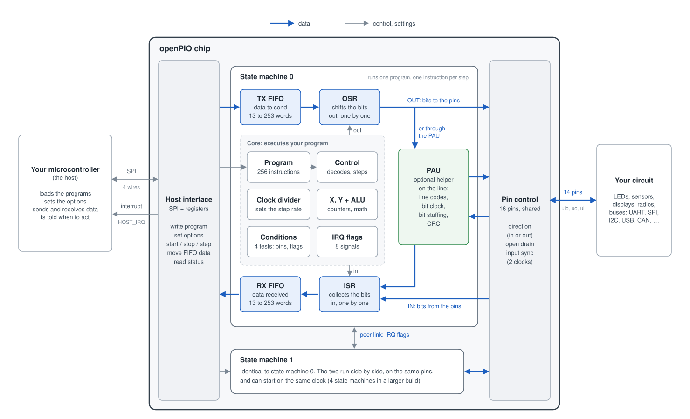
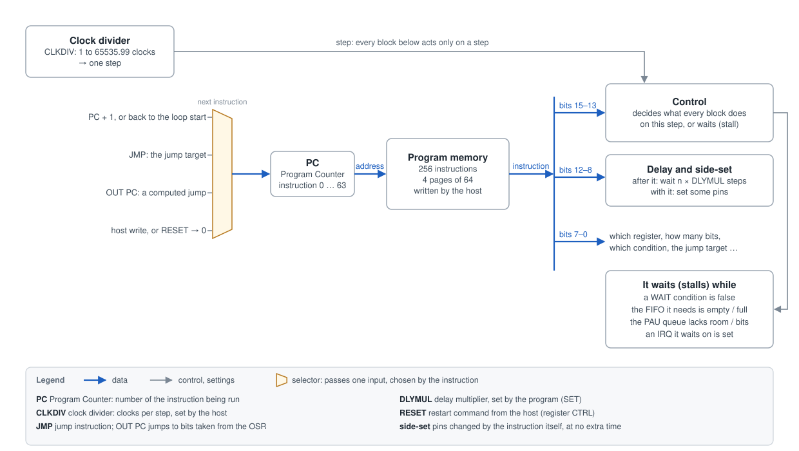
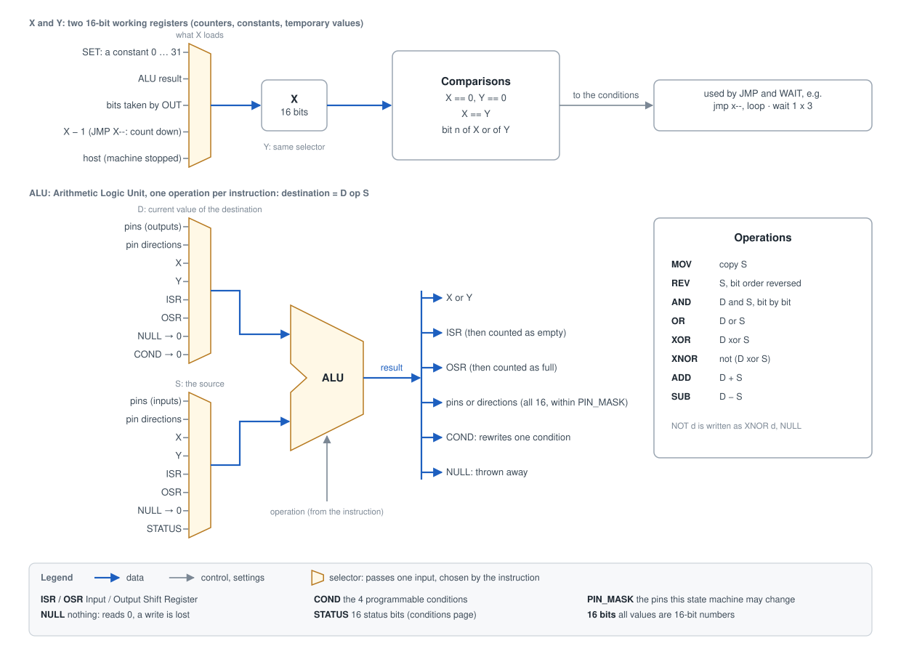
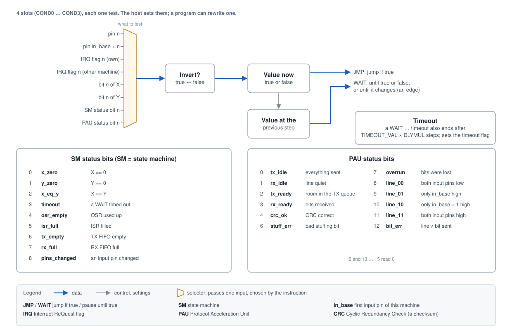
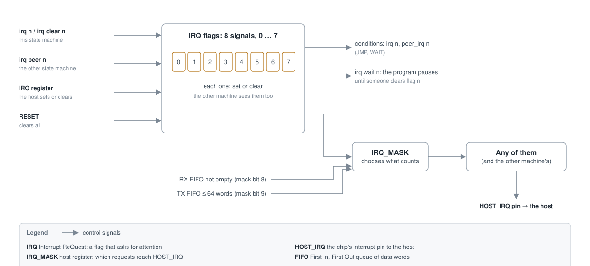
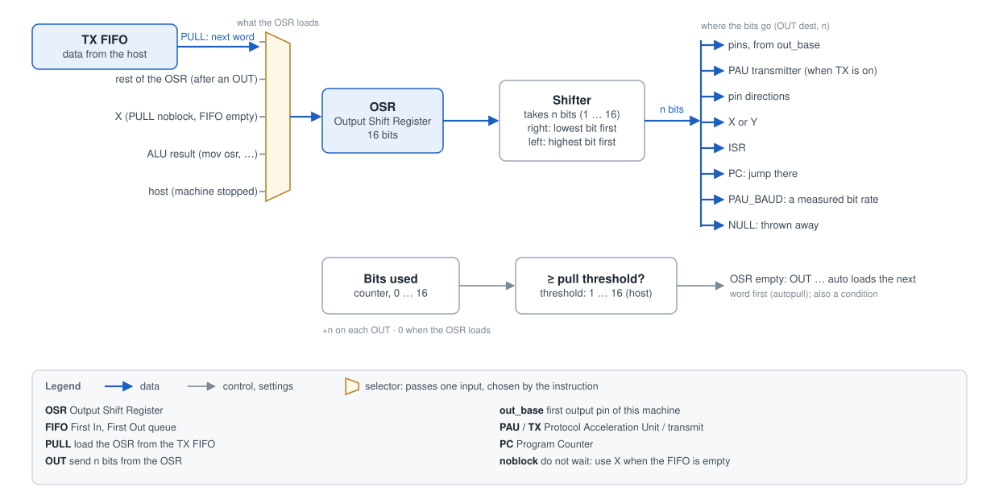
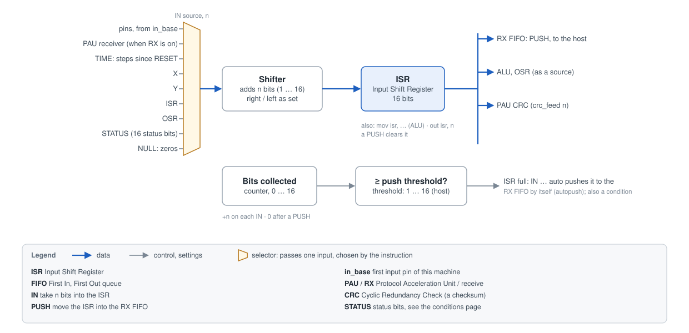
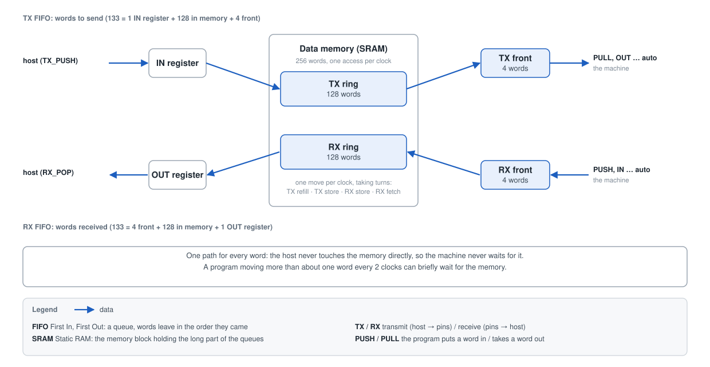
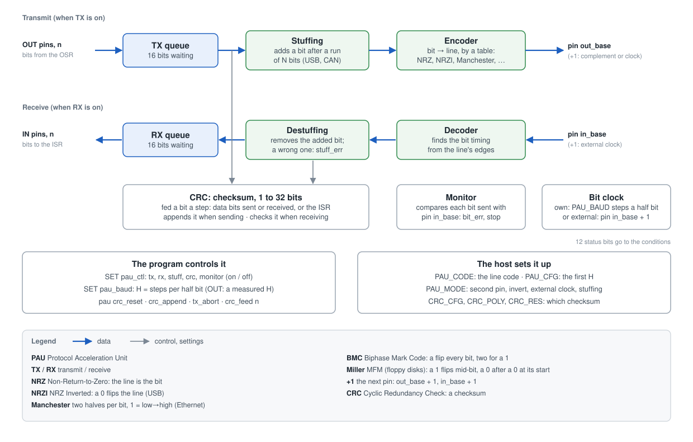

# How openPIO works

This page explains every part of the openPIO chip, one at a time, starting from what a serial
protocol is. It assumes no knowledge of chip design. The exact rules, bit by bit, are in
[sim/model/ISA.md](sim/model/ISA.md) (the instruction set) and
[sim/model/HOST.md](sim/model/HOST.md) (how a microcontroller talks to the chip).

## Contents

- [The problem](#the-problem)
- [Words used on this page](#words-used-on-this-page)
- [The whole chip](#the-whole-chip)
- [The journey of a byte](#the-journey-of-a-byte)
- [The host interface](#the-host-interface)
- [The state machine](#the-state-machine)
  - [Program and control](#program-and-control)
  - [X, Y and the ALU](#x-y-and-the-alu)
  - [Conditions](#conditions)
  - [IRQ flags](#irq-flags)
  - [OSR: the output path](#osr-the-output-path)
  - [ISR: the input path](#isr-the-input-path)
  - [FIFOs](#fifos)
- [The PAU](#the-pau)
- [Pins](#pins)
- [Two state machines together](#two-state-machines-together)
- [Why the timing is exact](#why-the-timing-is-exact)

## The problem

Electronic devices talk to each other over a few wires by switching the voltage on them
between low (0) and high (1). The rules of a conversation (how long a bit lasts, how a message
starts and ends, how errors are found) are called a **protocol**. There are many: UART, SPI,
I2C, CAN, USB, 1-Wire, and hundreds of less known ones.

A microcontroller has hardware for a few protocols. For any other one it has to **bit-bang**
it: its program switches a pin on and off and waits between the switches. This keeps the
processor busy doing nothing but waiting, and any interruption delays a bit and can break the
protocol.

openPIO is a small helper chip for this job. The microcontroller gives it a short program that
describes the protocol, then just hands it bytes to send and collects the bytes it receives.
openPIO keeps the timing of every bit exact.

## Words used on this page

| Word | Meaning |
|---|---|
| **bit** | a single 0 or 1 |
| **word** | 16 bits handled together; every number inside openPIO is a 16-bit word |
| **pin** | a metal contact of the chip: one wire to the outside world |
| **clock** | a signal that ticks at a fixed rate (50 million times a second on the chip); everything in the chip moves forward one tick at a time |
| **step** | the tick of a state machine: every clock, or every 2nd, 3rd, ... clock, as set by its clock divider. The specification calls it a *strobe* |
| **register** | a small piece of memory inside the chip that holds one word |
| **host** | the microcontroller that controls openPIO |
| **program** | a list of instructions; an instruction is one simple action, such as "set this pin to 1" |
| **TX / RX** | transmit (send) / receive |

## The whole chip

From left to right:

- **Your microcontroller**, the host, is connected to the chip by SPI (4 wires), a common and
  simple way for two chips to exchange data, and by an interrupt wire, HOST_IRQ, that the chip
  raises when it needs attention.
- **The host interface** receives the host's commands: load a program, change a setting, start
  or stop, send data, read data.
- **Two state machines** do the work. Each one is a tiny processor that runs its own program.
  They are identical and can work together.
- **The PAU** (Protocol Acceleration Unit) is an optional helper inside each state machine. It
  does the parts of a protocol that are too fast or too fiddly for a program.
- **Pin control** connects the state machines to the pins and decides, for each pin, whether
  the chip drives it or listens to it.
- **Your circuit** is whatever openPIO talks to: a sensor, a display, a radio module, a USB
  device, another microcontroller.

Data moves in a straight line, one way in each direction. Blue arrows in the drawings are data,
grey arrows are control and settings.

## The journey of a byte

Sending the letter `A` (the byte 0x41) over a UART, the protocol of a serial port:

1. The host writes the byte to the chip over SPI. It lands in the **TX FIFO**, a queue of
   words waiting to be sent.
2. The program running in a state machine executes `pull`: the word moves from the queue into
   the **OSR** (output shift register).
3. The program drives the pin low for one bit time: the *start bit*, which tells the receiver a
   byte is coming.
4. The program executes `out pins, 1` eight times: each time the OSR hands one bit to the pin.
   Between the bits the program waits a fixed number of steps, so that every bit lasts exactly
   as long as the protocol says.
5. The program drives the pin high for one bit time: the *stop bit*. Then it goes back to
   step 2 for the next byte.

Receiving is the mirror image: the program waits for the start bit, takes 8 bits from the pin
into the **ISR** (input shift register) with `in pins, 1`, then executes `push`, which puts the
word into the **RX FIFO**, where the host reads it over SPI.

The whole UART transmitter is eight instructions:
[programs/uart/uart_tx.asm](programs/uart/uart_tx.asm). The rest of this page describes each
block on that journey.

## The host interface

The host talks to the chip over **SPI**. SPI has four wires: a clock (SCLK) that the host
ticks, a data wire from the host to the chip (MOSI), a data wire back (MISO), and a select wire
(CS_N) that the host pulls low while it is talking.

Every exchange, called a *transaction*, starts with a 16-bit header that says what to do, and
continues with any number of 16-bit data words:

| Command | What it does |
|---|---|
| IMEM_WR / IMEM_RD | write / read the program of a state machine |
| REG_WR / REG_RD | write / read settings and status registers |
| TX_PUSH | put words into a state machine's TX FIFO (data to send) |
| RX_POP | take words out of its RX FIFO (data received) |

While the host sends a header, the chip sends back a status word at the same time on MISO
(FIFO full or empty, the program position), so the host learns the state without asking.

Some registers matter for everyday use:

- **CTRL** starts, stops, resets or single-steps the state machines. One write can start
  several at once, on the same clock.
- **IRQ_MASK** chooses which events raise the **HOST_IRQ** wire: a flag set by the program,
  data waiting in the RX FIFO, room in the TX FIFO. The host does not have to keep asking; the
  chip tells it.

Every command and register is in [HOST.md](sim/model/HOST.md). The host never needs to know
these numbers by heart: [sim/model/host.py](sim/model/host.py) is a ready-made driver, and the
assembler [sim/model/asm.py](sim/model/asm.py) turns a program's text into the words and
settings the host writes.

## The state machine

A state machine (SM) is a very small processor. It has:

- its own **program memory** of 256 instructions, four pages of 64: up to four programs, one
  running, written by the host;
- a **clock divider** that sets how fast it runs;
- two working registers, **X** and **Y**, and a small calculator, the **ALU**;
- four **conditions**, tests it can jump or wait on;
- eight **IRQ flags**, signals to the other state machine and to the host;
- two shift registers, the **OSR** and the **ISR**, that move bits out to and in from the pins;
- two **FIFOs**, queues of words to and from the host;
- a **PAU**, the optional line helper (its own section below).

### Program and control

The **clock divider** decides how often the state machine takes a step: with CLKDIV = 1 every
clock is a step, with CLKDIV = 10 every tenth clock. It also takes fractions (CLKDIV = 2.5 is a
step every 2.5 clocks on average), so a program can match any bit rate.

At every step the state machine runs the instruction at the position the **PC** (program
counter) points to. The PC then normally moves to the next instruction; a jump sets it
somewhere else. When it reaches the end of the loop it goes back to the start by itself, at no
cost (the *wrap*).

Each instruction is 16 bits in three parts:

- **bits 15-13, the kind of instruction:**

  | Instruction | What it does |
  |---|---|
  | `jmp` | jump to another instruction, always or when a test is true |
  | `in` | take bits into the ISR (from pins, the PAU, a register or a step counter) |
  | `out` | send bits from the OSR (to pins, the PAU, a register, or the PC) |
  | `mov`, `add`, `and`, ... | ALU operations between registers |
  | `push` / `pull` | move a word between a shift register and its FIFO |
  | `wait` | pause until a test becomes true, optionally with a time limit |
  | `irq` | set or clear a flag, optionally waiting for it to be cleared |
  | `set` | write a small constant (0 to 31) to pins, X, Y or a setting |
  | `pau` | ask the PAU to restart, append or feed a CRC, or to stop sending |

- **bits 12-8, delay and side-set:** after the instruction, the state machine can wait a few
  extra steps (the *delay*). This is how exact timing is written: `out pins, 1 [6]` sends a bit
  and then waits 6 more steps. Some of these bits can instead set a few pins at the same time
  as the instruction (*side-set*), for example a clock pin that must change together with the
  data.
- **bits 7-0, the arguments:** which register, how many bits, which test, which jump target.

An instruction can also **stall**: it waits, without moving on, until what it needs is ready.
A `pull` stalls while the TX FIFO is empty, a `wait` until its test is true. A stall is the
only way a program waits for something outside it, and it lasts exactly until that thing
happens.

### X, Y and the ALU

**X** and **Y** are two 16-bit registers for counting and remembering. The most common use is a
loop: `set x, 7` then `jmp x--, loop` repeats a part of the program 8 times (the jump is taken
while X is not 0, and X goes down by one each time).

The **ALU** (Arithmetic Logic Unit) is a small calculator. An ALU instruction takes the current
value of a destination D and a source S, and writes D op S back to D:

- `mov` copies S, `rev` copies it with the bit order reversed;
- `and`, `or`, `xor`, `xnor` combine D and S bit by bit, for masks and comparisons;
- `add` and `sub` add and subtract.

Sources and destinations include X, Y, the ISR, the OSR, the pins, the pin directions and the
status bits. Writing to COND rewrites one of the conditions, so a program can change what it
tests.

### Conditions

`jmp` and `wait` need a yes-or-no test. Each state machine has **4 condition slots**, and each
slot holds one test, chosen from:

- the level of a pin;
- an IRQ flag, its own or the other state machine's;
- one bit of X or of Y;
- a **status bit** of the state machine (X is 0, the TX FIFO is empty, a timeout happened, ...)
  or of the PAU (everything sent, CRC correct, a bit was lost, ...).

A test can be inverted (true becomes false). The host fills the slots before the program runs,
and the program can change one with the ALU while it runs. Four slots are enough for every
protocol in [programs/](programs/), and keeping them as slots keeps instructions short.

`wait` can wait for a test to be true or false, or for it to *change* (an edge: a pin going
from 0 to 1, say). With a time limit, a `wait` also ends after a set number of steps and sets
the *timeout* status bit: this is how a program measures whether a pulse was short or long.

### IRQ flags

Each state machine has **8 flags**: bits that are either set or clear. A program sets and
clears them with `irq`, the other state machine can set and clear them too, and so can the host.
They are used:

- **between the two state machines:** one waits on a flag, the other sets it when it is time
  to go. For example, a transmitter tells a receiver "I have finished sending, start listening";
- **to call the host:** a flag can raise the HOST_IRQ wire (through IRQ_MASK), for example
  "a frame has arrived" or "error".

*IRQ* stands for Interrupt ReQuest: a signal that asks for attention.

### OSR: the output path

The **OSR** (Output Shift Register) holds one 16-bit word that is being sent. `pull` loads it
with the next word from the TX FIFO. Each `out` then takes the next n bits (1 to 16) from it
and sends them somewhere: to pins, to the PAU, to X or Y, or even to the PC, which makes a jump
to a position computed from the data.

The bits can leave lowest first (*shift right*, as in UART) or highest first (*shift left*,
as in SPI); the host chooses.

A counter remembers how many bits have been used. With **autopull** on, when the word is used
up, the next `out` loads the next word from the FIFO by itself, so a long stream of bits flows
without a `pull` instruction in the loop.

### ISR: the input path

The **ISR** (Input Shift Register) is the mirror of the OSR: each `in` adds n bits to it, from
pins, from the PAU, from X or Y, from the status bits, or from **TIME**, a counter of the steps
since the state machine was reset (so a program can measure how long a pulse lasted). `push` moves the
word into the RX FIFO, towards the host.

With **autopush** on, once enough bits are collected (for example 8 for a byte), the `in` pushes
the word by itself.

### FIFOs

A **FIFO** (First In, First Out) is a queue: words leave in the order they came in. Each state
machine has two:

- the **TX FIFO** carries words from the host to the program;
- the **RX FIFO** carries words from the program to the host.

Each holds up to **133 words**, so the host can send or collect data in bursts, and the program
can keep running while the host is busy with something else. The two share one memory block,
and the host can move the line between them: up to **253 words** one way and 13 the other, for
an Ethernet frame to send, or to receive faster than the host can read it.

Inside, each queue has three parts: a register on the host's side, a long ring in a memory block
(SRAM; 128 words each by default), and 4 fast words next to the program. The memory can do one thing per
clock, so the four kinds of moves take turns. The program only ever touches the 4 fast words,
so it never waits for the memory unless it moves more than about one word every two clocks.

## The PAU

Some parts of a protocol are too fast or too fiddly to do with instructions, one bit at a time.
The **PAU** (Protocol Acceleration Unit) does them in hardware, between the shift registers and
the pins. It is optional: a program that does not turn it on uses the pins directly, as in the
UART example.

When the PAU transmitter is on, `out pins` puts bits into its 16-bit **TX queue** instead of on
the pin; the PAU sends them with exact timing while the program goes on. When the receiver is
on, `in pins` takes bits from its **RX queue**, already decoded. Along the way:

- **Line code.** A bit is not always just "low for 0, high for 1" on the wire. USB, for
  example, uses NRZI: a 0 flips the line, a 1 leaves it as it is. Ethernet uses Manchester: each
  bit is a change in the middle of its time. The PAU reads the code from a 16-bit table
  (PAU_CODE) that says what the line does in each half of a bit, so it handles the common codes
  (NRZ, NRZI, Manchester, BMC, Miller, ...) and others with no new hardware.
- **Bit clock.** The PAU times the bits itself, H steps for each half of a bit (PAU_BAUD), or
  follows a clock wire from the other device, as in SPI. A program can set H from a rate it
  measured (*autobaud*).
- **Clock recovery.** When receiving, the PAU finds where each bit starts from the changes on
  the line, so it stays in step with a sender whose clock is slightly fast or slow.
- **Bit stuffing.** Some protocols (USB, CAN, HDLC) insert an extra bit after a run of equal
  bits, so the line never stays still for long. The PAU adds these bits when sending and removes
  them when receiving, and reports a wrong one.
- **CRC.** A CRC (Cyclic Redundancy Check) is a checksum: a number computed from the bits of a
  message, sent after it, that lets the receiver detect errors. The PAU computes any CRC from 1
  to 32 bits as the bits pass, appends it when sending, and tells the program whether a
  received message was correct.
- **Monitor.** On a shared wire (CAN, LIN, 1-Wire) several devices can talk at once. The PAU
  compares each bit it sends with the line; if another device overrides it, it stops at once
  and reports it. This is how CAN decides which device keeps talking.

The host sets up the protocol's parameters once (which line code, which CRC, which stuffing
rule); the program turns the parts on and off as a message goes by. A protocol is then one
choice in each of these few dimensions, plus a short program for the framing. USB low speed,
for example, is NRZI, two complementary pins, stuffing after six 1s, a CRC-16, and a
19-instruction program.

## Pins

The instruction set has **16 pin positions**, numbered 0 to 15. Each chip connects them to its
real contacts. On the Tiny Tapeout chip, 14 are usable:

| Pins | What they can do |
|---|---|
| 0 to 7 | input or output on the same contact |
| 10 | output only |
| 11 to 15 | output and input, on two separate contacts |
| 8, 9 | none: those contacts belong to the SPI link with the host |

**Pin control**, the bar on the right of the big drawing, does three things:

- **Direction.** Each pin is either an *output* (the chip sets its level) or an *input* (the chip
  only reads it). Programs change the direction with `set pindirs` or `out pindirs`.
- **Open drain.** Some buses (I2C, 1-Wire, SWD) share one wire between several devices. Every
  device may only pull the wire low or let go of it; a resistor pulls it high when nobody pulls
  it low. The host marks such pins as *open drain*, and then the chip never drives them high.
- **Input synchronizer.** A signal from outside can change at any moment, even in the middle of
  a clock tick. Each input passes through two flip-flops first (a *2-flip-flop synchronizer*),
  so the chip always sees a clean 0 or 1, exactly two clocks late. Because the delay is always
  the same, it never upsets the timing.

## Two state machines together

The two state machines run side by side on the same pins:

- they can **start on the same clock**, with one write of the host;
- they **signal each other** through IRQ flags: each can set, clear and test the other's flags;
- they **share the pins**: each state machine has a PIN_MASK, the pins it is allowed to change,
  so they do not get in each other's way. If both change the same pin at the same time, state
  machine 1 wins.

Typical pairs: one transmits while the other receives (full duplex), or one generates a clock
while the other talks to a device on it.

## Why the timing is exact

Every instruction takes a known number of steps, and nothing on the state machine's path waits
for something it cannot see: there is no cache, no shared bus, and the input delay is always
the same two clocks. The timing of a program can therefore be read from
its text: `out pins, 1 [6]` followed by `jmp x--, bit` is exactly 8 steps per bit, every time.
This is what lets openPIO do in hardware what a microcontroller struggles to do in software.

The drawings on this page are generated by [docs/diagrams.py](docs/diagrams.py).
