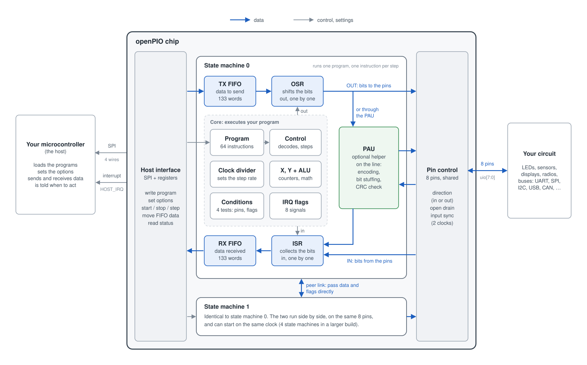

**openPIO** is a lightweight, fully open-source protocol emulator and I/O co-processor targeting the **IHP 130nm CMOS5L** process via Tiny Tapeout.

Imagine you need to talk to a sensor, a display, or a custom device using a serial protocol (like UART, SPI, or I2C). 

Normally, you have two choices:
1. **Use a fixed hardware peripheral**: If your microcontroller has a spare UART or SPI port, great. But if you run out of them, or if you need a non-standard protocol, you are out of luck.
2. **"Bit-bang" it in software**: You manually toggle GPIO pins high and low from your main CPU code using delay loops or timer interrupts.

Option 2 sounds easy, but it quickly falls apart:
* **Your CPU wastes time**: It spends precious clock cycles doing nothing but waiting a few microseconds between pin toggles.
* **Jitter and broken timing**: A single background task or interrupt can delay your code by a couple of microseconds, corrupting the packet and crashing the communication.

What if you had a tiny, separate hardware helper whose only job was to flick pins up and down with cycle-accurate precision, completely independent of your main CPU?

That is what a **PIO (Programmable Input/Output)** does, a concept made famous by the Raspberry Pi RP2040. It is a tiny, stripped-down processor with a custom instruction set designed purely for shifting bits into and out of pins with zero timing jitter.

openPIO gives you programmable state machines backed by dedicated, toggleable micro-hardware.



- **Instruction set**: [sim/model/ISA.md](sim/model/ISA.md): instructions, programmable conditions, the PAU (Protocol Acceleration Unit: line codes, bit stuffing, CRC, clock recovery), FIFOs, timing within a clock.
- **Host interface**: [sim/model/HOST.md](sim/model/HOST.md): SPI commands, registers, pins.
- **Programs**: [programs/README.md](programs/README.md): 19 protocols, a logic analyzer and an edge timestamper, each judged on the pins by a reference device.
- **Learning a protocol**: [sim/learn/learn.py](sim/learn/learn.py) finds a protocol's parameters from a recording of the wire and writes the openPIO programs that receive and send it.
- **Datasheet**: [docs/info.md](docs/info.md) (Tiny Tapeout).

> [!NOTE]
> This project is developed with great assistance from AI: lots of Q&A on the architectural choices and agents implementing the code. Humans steer the ideas and the vision.

## Development environment

All tools (Yosys, Icarus Verilog, Verilator, SymbiYosys, nextpnr-himbaechel, openFPGALoader, cocotb) run in a container defined by `Containerfile`; nothing is installed on the host. Requires podman (or docker).

```
scripts/dev.sh                                    # shell inside the container
scripts/dev.sh python3 test/lockstep/fuzz.py      # run one command
```

The image is built on first use and rebuilt whenever `Containerfile` changes. Only the repository is mounted.

### Tests

The reference model (`sim/model/`: assembler `asm.py`, one state machine `emu.py`, the chip `chip.py`, the host driver `host.py`) and the programs run in plain Python, in seconds (`model` workflow):

```
for t in test/model/test_*.py; do python3 "$t"; done   # ISA, assembler, chip model
(cd test/shared && python3 test_devices.py)            # reference devices against known traces
python3 programs/report.py                             # every program; rewrites programs/README.md
```

The RTL (`src/`) still implements ISA v1 and is being ported to v2; its tests below follow it.

`test/test.py` holds the cocotb tests of the whole chip (Tiny Tapeout layout): a bit-banged SPI host programs it, and the PIO pins are checked against known data and `sim/model/emu.py`. They run on every relevant push (`test` workflow) and on the hardened netlist after each gds run (`gl_test` job).

```
cd test
../scripts/dev.sh make -B                                 # RTL; results.xml, waveforms in tb.fst
../scripts/dev.sh make -B IMEM=sram PDK_ROOT=<pdk dir>    # RTL with the chip's SRAM IMEM
../scripts/dev.sh make -B GATES=yes PDK_ROOT=<pdk dir>    # gate level, see below
```

On the chip the instruction memory is an IHP SRAM macro (`src/imem_sram.v`, listed in `info.yaml`); `src/imem.v` is its flip-flop model, used by the RTL tests, formal, lockstep and the FPGA build. `IMEM=sram` and gate level need IHP-Open-PDK models under `<pdk dir>`, inside the repository so the container sees them: `ihp-sg13cmos5l/libs.ref/sg13cmos5l_sram/verilog/` (SRAM) and, for gate level, `ihp-sg13cmos5l/libs.ref/{sg13cmos5l_stdcell,sg13cmos5l_io}/verilog/*.v` (cells). Gate level also needs `test/gate_level_netlist.v` (the `.v` file of the `tt_submission` artifact of a gds run).
