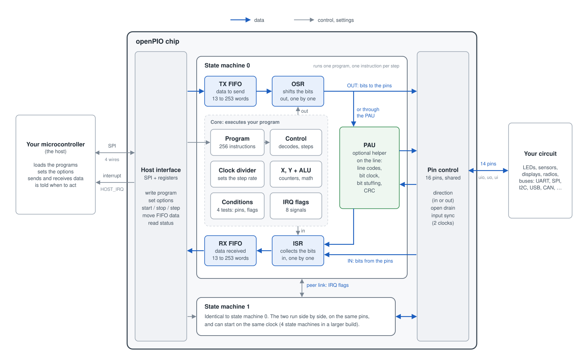

**openPIO** is a small, fully open-source chip that speaks serial protocols for you: UART, SPI, I2C, CAN, USB, 1-Wire and many more, including ones it was not designed for. It is built on the **IHP 130 nm CMOS5L** process through Tiny Tapeout.

## Why

A microcontroller that needs a protocol it has no peripheral for has to *bit-bang* it: toggle pins from software, with delay loops in between. The CPU then spends its time waiting, and any interrupt shifts the timing by a few microseconds, which is enough to break the protocol.

A **PIO** (Programmable Input/Output, made popular by the Raspberry Pi RP2040) is a tiny helper processor that does only this: move bits between pins and memory, with timing exact to the clock cycle. Your CPU hands it bytes and gets bytes back.

openPIO is a PIO built around one idea: **a serial protocol is a short program plus a few settings.**

## The idea in two layers

| Layer | Decides | What it is |
|-------|---------|------------|
| **State machine (SM)** | *when* things happen | A tiny processor that runs a program of up to 64 instructions, one of four it holds. Every instruction takes a known number of steps, so a program's timing can be read off its text: no caches, no waiting on shared buses. |
| **PAU** (Protocol Acceleration Unit) | *how a bit looks on the wire* | An optional helper between the SM and the pins that does what software cannot do fast enough: line codes (NRZ, NRZI, Manchester, Miller, ...), bit stuffing, CRCs, recovering the clock from the data, an external bit clock, watching a shared bus for collisions. Each one is a setting, not a protocol. |

A protocol is then a point in a small space of settings, plus a program for the rest. USB low speed, for example, is NRZI on two complementary pins, bit stuffing and a CRC-16 on the PAU, and a 19-instruction program that frames the packets.

## Architecture



Data flows in a straight line, one way in each direction:

- **Sending:** the host writes words over SPI into the **TX FIFO** (a queue). The SM pulls a word into its **OSR** (output shift register), which feeds the bits out one at a time, to the pins directly or through the PAU.
- **Receiving:** bits from the pins (or the PAU) shift into the **ISR** (input shift register). When it is full, the SM pushes the word into the **RX FIFO**, where the host reads it.

The parts of each state machine ([ARCHITECTURE.md](ARCHITECTURE.md) explains each one, with a drawing):

| Block | Role |
|-------|------|
| Program memory | 256 instructions, four programs of up to 64, loaded by the host |
| Clock divider | sets the step rate: one instruction per step, the step being any fraction of the 50 MHz clock |
| X, Y and the ALU | two 16-bit registers for counters and simple math (add, subtract, and, or, xor, reverse bits) |
| Conditions | four tests a jump can use: a pin, a flag, a register bit, a FIFO or PAU status |
| IRQ flags | 8 signals between the two SMs and to the host |
| FIFOs | 133 words each way, so the host can send and read in bursts; the host can move the split, up to 253 one way (a long frame to send or to receive) |
| Pin control | 16 pin positions shared by both SMs; each pin is an input, an output, or open drain (for buses like I2C) |

The two SMs run side by side on the same pins, can start on the same clock, and signal each other through IRQ flags: one can transmit while the other receives, or one can generate a device's clock while the other talks to it.

## A program

A UART transmitter, 8 data bits, 1 stop bit. With 8 steps per bit, the baud rate is the clock divided by 8 and the clock divider.

```
    set pins, 1             ; the line idles high
    set pindirs, 1          ; the pin is an output
.wrap_target
    pull block              ; wait for a byte from the host
    set pins, 0 [6]         ; start bit: drive low, wait 6 more steps
    set x, 7                ; 8 data bits to go
bit:
    out pins, 1 [6]         ; next bit to the pin
    jmp x--, bit            ; loop over the bits
    set pins, 1 [6]         ; stop bit
.wrap                       ; back to the pull
```

`[6]` is a delay: the instruction holds for 6 more steps, which is how exact timing is written. The full file is [programs/uart/uart_tx.asm](programs/uart/uart_tx.asm).

## What it runs

24 protocols and a logic analyzer, each tested on its pins against a reference device written from the protocol's specification: CAN, LIN, I2C, SPI, UART, USB low speed, USB Power Delivery, 10BASE-T Ethernet (transmit and receive), HDLC, Modbus, DALI, JTAG, SWD, 1-Wire, PS/2, I2S, WS2812B, NEC infrared, SENT, ISO 7816 smart cards, MIL-STD-1553B, SD cards, an MFM disk controller and a quadrature encoder. Several of them were written after the instruction set was frozen, without changing the hardware. See [programs/README.md](programs/README.md).

[sim/learn/learn.py](sim/learn/learn.py) goes the other way: from a one-way recording of a line it finds the line's settings and writes an openPIO receiver for them. It knows four families of line formats:

- asynchronous serial: bit time, parity, stop bits, and on request the breaks LIN and DMX frames start with; it also writes the transmitter;
- self-clocked frames: the line code, bit stuffing, sync bits and the CRC, whose polynomial it computes from the frames instead of looking it up in a table. The receiver hands each frame to the host with one extra word saying whether its CRC is right;
- lines with a clock pin: the clock, its SPI mode, the select pin and the CRC;
- pulse-width codes: which pulse carries the bits, their two widths and the leader.

It is tested on UART, LIN, USB, CAN, HDLC, DALI, MFM, biphase mark, SPI, SD card commands, PS/2, WS2812B, and on infrared and 433 MHz codes (NEC, Philips RC-5, Sony SIRC, an air conditioner remote, EV1527, a weather sensor): it learns each from a recording, and its receiver takes new frames. For 10BASE-T it learns the frames; its receiver takes them, and checks the FCS, from a half-bit of 3 clocks up (a 60 MHz clock: at 50 MHz the line is too fast for it). It learns the line, not the conversation: request-and-answer protocols on a shared wire (I2C, SWD, 1-Wire, ISO 7816) and the formats outside the four families (I2S, SENT, MIL-STD-1553B, 4B5B) need the hand-written programs above.

## The chip

| | |
|---|---|
| Process | IHP 130 nm CMOS5L, Tiny Tapeout, 8 x 4 tiles (1.72 x 0.71 mm) |
| State machines | 2, each with its own program memory (an SRAM) and FIFO memory (an SRAM) |
| Pins | 14 usable: 8 bidirectional, 6 input + output on separate pads |
| Host interface | SPI, plus an interrupt line |
| Clock | 50 MHz at typical conditions (1.2 V, 25 C); 42 MHz in the worst case (1.08 V, 125 C). Receiving 10BASE-T needs 60 MHz, which closes only at typical conditions (about 1.4 ns of slack): a bench experiment, not a signed-off rate |
| Size | 33k standard cells and 4 SRAMs, 10 mW |

## Documentation

- [ARCHITECTURE.md](ARCHITECTURE.md): how the chip works, block by block, for readers new to chip design.
- [docs/info.md](docs/info.md): datasheet: pins, host commands, how to test the chip.
- [sim/model/ISA.md](sim/model/ISA.md): the instruction set and the PAU, exactly.
- [sim/model/HOST.md](sim/model/HOST.md): the SPI commands and registers.
- [programs/](programs/): example programs, one folder per protocol.

`sim/model/` is the specification you can run: a Python model of the chip (`chip.py`), the assembler (`asm.py`) and a host driver (`host.py`). The Verilog in `src/` matches it clock for clock.

> [!NOTE]
> This project is developed with great assistance from AI: lots of Q&A on the architectural choices and agents implementing the code. Humans steer the ideas and the vision.

## Development

All tools (Yosys, Icarus Verilog, Verilator, SymbiYosys, nextpnr, openFPGALoader, cocotb) run in a container defined by `Containerfile`; nothing is installed on the host. Requires podman or docker.

```
scripts/dev.sh                                    # shell inside the container
scripts/dev.sh python3 test/lockstep/sm_fuzz.py      # run one command
```

The model and the programs run in plain Python, in seconds:

```
for t in test/model/test_*.py; do python3 "$t"; done   # instruction set, assembler, chip model
(cd test/shared && python3 test_devices.py)            # reference devices against known traces
python3 programs/report.py                             # every program; rewrites programs/README.md
```

The Verilog is checked three ways: stepped against the model every clock (`test/lockstep/`), driven through its pins by cocotb (`test/test.py`), and with formal proofs (`test/formal/`).

```
cd test
../scripts/dev.sh make -B                                 # Verilog; waveforms in tb.fst
../scripts/dev.sh make -B IMEM=sram PDK_ROOT=<pdk dir>    # with the chip's SRAM models
../scripts/dev.sh make -B GATES=yes PDK_ROOT=<pdk dir>    # the hardened netlist
```

On the chip the memories are IHP SRAM macros (`src/imem_sram.v`, `src/fifo_ram_sram.v`); `src/imem.v` and `src/fifo_ram.v` are flip-flop models of them, used by the default tests and the FPGA build. `IMEM=sram` and `GATES=yes` need the IHP-Open-PDK models under `<pdk dir>`, inside the repository so the container sees them; `GATES=yes` also needs `test/gate_level_netlist.v`, from the `tt_submission` artifact of a `gds` run.

## License

MIT: see [LICENSE](LICENSE).
