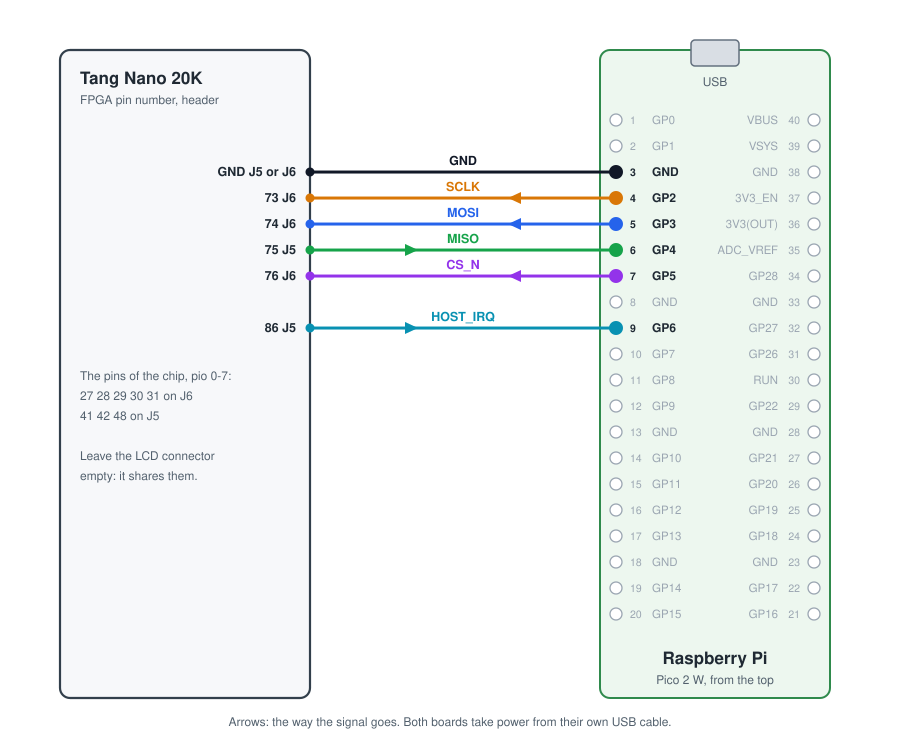
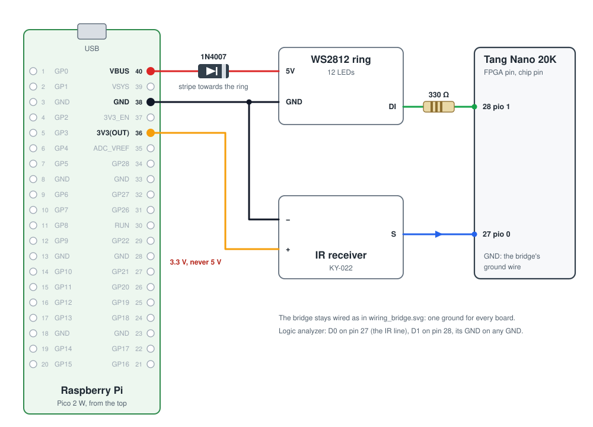

# Wiring the Tang Nano 20K

How to connect the boards, step by step. Three groups of wires, each optional except the
first:

1. [The bridge](#1-the-bridge-pico-to-tang-nano): the Raspberry Pi Pico talks to the chip
   on the FPGA. Always needed.
2. [The logic analyzer](#2-the-logic-analyzer): records the chip's pins.
3. [The demo parts](#3-the-demo-parts): an infrared receiver and a ring of WS2812 LEDs.

The drawings are made by `python3 fpga/tang_nano_20k/wiring.py`.

## Before you start

- **Unplug both USB cables while you wire.** Plug them back in only when every wire is in place.
- **Only 3.3 V on the FPGA's pins.** 5 V on any of them can damage the FPGA.
- **One ground for everything.** Every board and part shares its GND with the others; without
  it the signals have no reference and nothing works, or works by chance.
- **Leave the Tang Nano's LCD connector empty.** The chip's pins are shared with it.
- **Short jumpers**, 10-20 cm, especially for the five SPI wires.
- **Find the pins by number.** The Pico's pins are numbered 1 to 40 (pin 1 is next to the USB
  connector, on the left with the board seen from the top). The Tang Nano's header pins are
  named by the FPGA's pin number, printed next to each one on the board; Sipeed's pinout
  drawing of the Tang Nano 20K shows them too. Its two headers are J5 and J6.

## 1. The bridge: Pico to Tang Nano

Six wires. Each board takes power from its own USB cable: do not connect any power pin
between them, only the signals and ground.

| Wire | Pico pin | Pico name | Tang Nano pin | Header | Way |
|---|---|---|---|---|---|
| SCLK, the clock | 4 | GP2 | 73 | J6 | Pico → Tang |
| MOSI, data to the chip | 5 | GP3 | 74 | J6 | Pico → Tang |
| MISO, data from the chip | 6 | GP4 | 75 | J5 | Tang → Pico |
| CS_N, chip select | 7 | GP5 | 76 | J6 | Pico → Tang |
| HOST_IRQ, the chip asks for attention | 9 | GP6 | 86 | J5 | Tang → Pico |
| GND | 3 (or 8, 38) | GND | any GND | J5 or J6 | — |

Then, with both USB cables plugged into the PC:

1. Load the FPGA: `fpga/tang_nano_20k/build.sh load`. LED 5 of the Tang Nano blinks slowly:
   the design is running.
2. Check the wires: `python3 board/bringup.py`. Every line says `ok`. A `FAIL` names the part
   that is wrong: `id` is MISO, SCLK or CS_N (or the FPGA not loaded), `lines` a loose MOSI or
   MISO wire, `irq` the HOST_IRQ wire.

The Pico's setup (MicroPython and its program) is in [board/README.md](../../board/README.md).

## 2. The logic analyzer

The chip's eight pins, `pio 0` to `pio 7`, are these Tang Nano pins:

| Chip pin | pio 0 | pio 1 | pio 2 | pio 3 | pio 4 | pio 5 | pio 6 | pio 7 |
|---|---|---|---|---|---|---|---|---|
| Tang Nano pin | 27 | 28 | 29 | 30 | 31 | 41 | 42 | 48 |
| Header | J6 | J6 | J6 | J6 | J6 | J5 | J5 | J5 |

Connect the analyzer's channel D0 to pio 0, D1 to pio 1 and so on, and **its GND to a GND pin**
of the Tang Nano. A part on a pin (such as the IR receiver) and the analyzer's probe can share
the pin: the probe only listens.

## 3. The demo parts

The infrared receiver on pio 0, the LED ring on pio 1. Both take power from the Pico, which
has a 3.3 V output and the USB's 5 V. The bridge stays wired as in step 1.

**Infrared receiver** (KY-022, three pins):

| Receiver pin | Goes to |
|---|---|
| `−` | Pico pin 38, GND |
| `+` | Pico pin 36, 3V3(OUT) |
| `S`, the signal | Tang Nano pin 27, pio 0 |

Power it from **3.3 V, never 5 V**: its signal comes out at its supply voltage, and 5 V on
pin 27 would damage the FPGA. Its LED blinks when it receives a remote's key.

**WS2812 ring** (pads 5V, GND, DI, DO; DO stays free):

| Ring pad | Goes to |
|---|---|
| 5V | Pico pin 40, VBUS (5 V from USB), through the 1N4007 diode |
| GND | Pico pin 38, GND |
| DI, data in | Tang Nano pin 28, pio 1, through the 330 Ω resistor |

- **The diode** has a stripe on one end: the stripe goes **towards the ring**. It lowers the
  ring's supply to about 4.3 V; at that voltage the LEDs read the FPGA's 3.3 V data reliably
  (at 5 V they need about 3.5 V). Turned the other way, the ring gets no power.
- **The resistor** goes either way round. It protects the first LED's input from ringing on
  the wire.
- **Keep the colours dim** in the programs: 12 LEDs at full white draw about 0.7 A, more than a
  USB port gives.

Wrong colours or flickering LEDs: a shorter DI wire, the ground shared, the diode's stripe.

## Checklist

- [ ] Both USB cables unplugged while wiring.
- [ ] Six bridge wires, ground included; no power pin between the Pico and the Tang Nano.
- [ ] LCD connector empty.
- [ ] Nothing at 5 V on a Tang Nano pin: the IR receiver on 3.3 V, the ring's 5 V only to
      the ring.
- [ ] The diode's stripe towards the ring.
- [ ] The analyzer's GND on a GND pin.
- [ ] `build.sh load`, LED 5 blinking, then `bringup.py` all `ok`.
